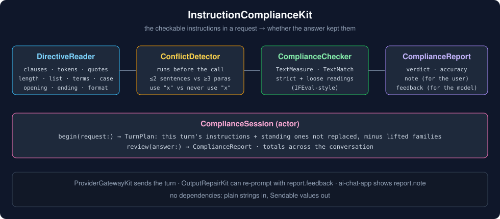
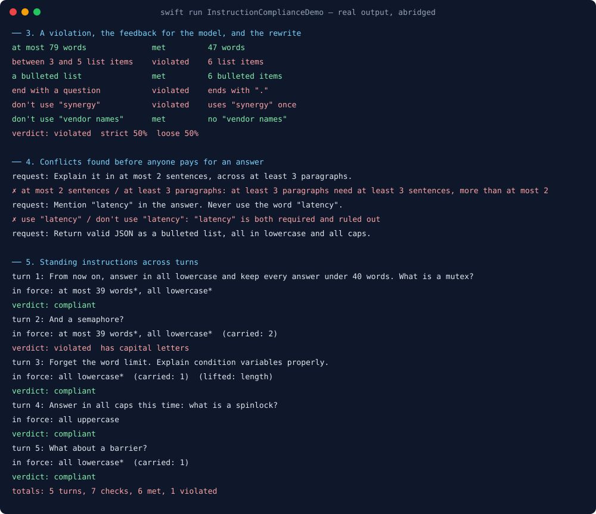
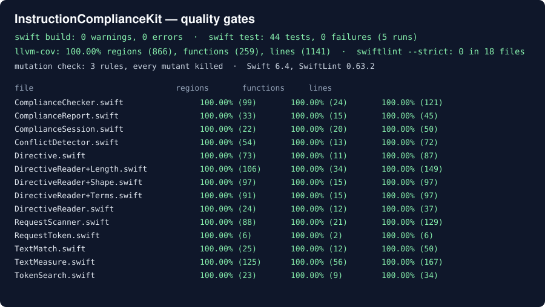

# InstructionComplianceKit



A user asks for a summary "in under 80 words, as 3 to 5 bullet points, without the word *synergy*,
ending with a question". The model sends back six bullets, one of them about the team's synergy, and
ends on a full stop. Each bullet reads well, and nothing on screen says that half of what the user
asked for was ignored. The same happens with "answer in lowercase from now on" two turns later, with
"plain text, no markdown" answered in bold, and with "return valid JSON" answered with a sentence
before the JSON.

InstructionComplianceKit reads the instructions in a request that a program can check, checks the
answer against each of them, and says which ones it broke, in words for the user and in a rewrite
prompt for the model. It also notices when two instructions in a request cannot both hold, before
anyone pays for an answer, and keeps "from now on" instructions across a conversation until they are
replaced or lifted.

Part of the Swift LLM ecosystem around
[`ProviderGatewayKit`](https://github.com/rajatslakhina/foundation-model-provider-gateway).

## Why

IFEval (Zhou et al., *Instruction-Following Evaluation for Large Language Models*, arXiv 2311.07911)
made instruction following measurable by restricting it to instructions a program can verify: word and
sentence counts, required and forbidden keywords, letter case, bullet counts, exact endings, JSON. It
scores each instruction strictly, and loosely after removing a first line, a last line or asterisks,
so a polite preamble does not count as a failure on its own. IFBench (Pyatkin et al., *Generalizing
Verifiable Instruction Following*, arXiv 2507.02833) showed that models tuned on IFEval's constraints
do much worse on constraints they have not seen. A model that scores well on a leaderboard still
breaks "no more than three bullets" in your app, and you only find out if something checks.

Those checkers are benchmark code: they take a prompt that was written with the constraint already
labelled. A chat client gets free text from a user. This package does the reading: it finds the
constraint in "Summarize this 2,000-word report in under 80 words", knows the 2,000 describes the
report and the 80 limits the answer, and turns "don't use a numbered list, use bullets" into "a
bulleted list" rather than "no lists".

Nothing else in this ecosystem looked at this. `StructuredOutputKit` validates JSON against a schema
the developer wrote; `OutputRepairKit` re-prompts until that schema passes; `ScopeDriftKit` watches what
an agent is allowed to do. None of them read what the user asked the answer to look like.

## What it gives you

| Instruction | Read from | Checked as |
|---|---|---|
| `length(unit, bound)` | "under 80 words", "no more than two paragraphs", "3 to 5 bullet points", "a 100-word limit", "in one sentence", "about 200 words" | words, sentences, paragraphs, list items or characters against `atMost`, `atLeast`, `exactly`, `between`, `around` (±20%) |
| `list(style)` / `noList` | "as bullet points", "a numbered list", "no lists", "in prose" | bulleted (`-`, `*`, `•`, `+`) or numbered (`1.`, `2)`) lines |
| `include(term)` / `exclude(term)` | `use the word "latency"`, `avoid "delve"`, "don't mention the vendor names", "no mention of pricing" | whole word, case-insensitive, plural tolerant |
| `letterCase` | "all lowercase", "in all caps", "no capital letters" | every letter |
| `startsWith` / `endsWith` | `start with "Yes" or "No"`, `sign off with "Cheers"` | case-insensitive; a closing full stop is allowed |
| `endsWithQuestion` | "end with a question", "ask me a question at the end" | last significant character is `?` |
| `format` | "valid JSON", "in a table", "plain text, no markdown" | parses as an object or array (a code fence is allowed); a markdown table; no headings, bold, fences, tables or links |
| `noCommas` | "don't use any commas" | no `,` |

- **`DirectiveReader`** splits a request into clauses (quotes stay whole), reads number words
  ("twenty five", "two hundred"), and leaves alone what it would read wrongly: counts that describe the
  material ("this 2,000-word report", "the draft is 900 words"), bounds on each part ("2 paragraphs, each
  under 60 words", "10 words per bullet"), and unquoted words the user wants included ("mention the
  price"), which a model can honour with a synonym.
- **`ComplianceChecker`** checks every instruction strictly and loosely and records what the answer
  shows: "143 words", `uses "synergy" once`, `ends with "."`.
- **`ComplianceReport`** gives a verdict (`noDirectives`, `compliant`, `compliantLoosely`, `violated`),
  IFEval's instruction-level strict and loose accuracy, a `note` for the person and a `feedback` prompt
  for the model.
- **`ConflictDetector`** finds pairs no answer can satisfy: disjoint bounds on one unit, a coarse unit
  that needs more of a fine one than allowed (at least 3 paragraphs in at most 2 sentences), lowercase
  with uppercase, a list with no lists, a required word that is also forbidden, valid JSON as a list.
- **`ComplianceSession`** (actor) keeps standing instructions ("from now on", "always", "every answer")
  per slot. A later instruction in the same slot replaces one; "this time" overrides it for one turn;
  "forget the word limit" lifts a family.

## Usage

```swift
import InstructionComplianceKit

let session = ComplianceSession()
let plan = await session.begin(request: userMessage)
if let conflict = plan.conflicts.first {
    // Ask the user which one they meant before paying for an answer.
    showRefusal("\(conflict.first.summary) and \(conflict.second.summary) can't both hold: \(conflict.reason)")
}
let answer = try await gateway.send(userMessage)          // ProviderGatewayKit, or any model call
let report = await session.review(answer: answer)
switch report.verdict {
case .violated:
    let retry = try await gateway.send(answer + "\n\n" + (report.feedback ?? ""))  // or OutputRepairKit
    show(retry, note: report.note)
case .compliantLoosely, .compliant, .noDirectives:
    show(answer)
}
```

Without a session: `ComplianceChecker().report(answer:directives:)` with
`DirectiveReader().read(request).directives`.

### Rules that decide a result

- **Strict** reads the whole answer. **Loose** also accepts it without its first line, its last line or
  both, and without asterisks, as IFEval does, with two changes the demo forced: a line that is a list
  item is never set aside (dropping the sixth bullet would make six bullets pass "3 to 5"), and asterisks
  stay for list and plain-text instructions (removing them would excuse the bold or the `* ` bullets the
  instruction is about).
- **"under 80" is at most 79**, "over 100" is at least 101, "no more than 100" is at most 100. A bare
  count is a ceiling for words and characters ("in 50 words") and exact for sentences, paragraphs and
  list items ("in 3 sentences").
- **Words** are runs of letters and digits joined by apostrophes or hyphens; list markers are not words.
  **Sentences** end at `.`, `!`, `?` or `…` followed by a space or a line end, not after `e.g.`, `Dr.` or
  an initial; a line without closing punctuation is one sentence; headings are not sentences.
  **Paragraphs** are blocks between blank lines or `---`; a heading on its own is not a paragraph.

## Where it sits

- **ProviderGatewayKit** sends the turn. This package judges the answer that comes back.
- **OutputRepairKit** runs a bounded repair loop; `report.feedback` is a ready-made reason to feed it.
- **StructuredOutputKit** checks a schema the developer chose. This package checks the shape the user
  asked for in words, including "valid JSON" with no schema at all.
- **ai-chat-app** runs it as the `instructionCompliance` stage: the conflict check before the provider
  call, the answer check after it.

## Demo

`swift run InstructionComplianceDemo` runs seven scenarios. Real output, abridged (the whole run is in
[`Screenshots/demo-output.txt`](Screenshots/demo-output.txt)):

```
── 1. Reading one request
   request: Summarize this 2,000-word incident report in under 80 words, as 3 to 5 bullet points. Don't mention the vendor names, avoid the word "synergy", and end with a question.
   • at most 79 words
   • between 3 and 5 list items
   • a bulleted list
   • end with a question
   • don't use "synergy"
   • don't use "vendor names"

── 3. A violation, the feedback for the model, and the rewrite
   between 3 and 5 list items    violated    6 list items
   end with a question           violated    ends with "."
   don't use "synergy"           violated    uses "synergy" once
   verdict: violated  strict 50%  loose 50%

── 4. Conflicts found before anyone pays for an answer
   request: Explain it in at most 2 sentences, across at least 3 paragraphs.
   ✗ at most 2 sentences / at least 3 paragraphs: at least 3 paragraphs need at least 3 sentences, more than at most 2 sentences allows

── 5. Standing instructions across turns
   turn 2: And a semaphore?
     in force: at most 39 words*, all lowercase*  (carried: 2)
     verdict: violated  has capital letters
   turn 3: Forget the word limit. Explain condition variables properly.
     in force: all lowercase*  (carried: 1)  (lifted: length)
   turn 4: Answer in all caps this time: what is a spinlock?
     in force: all uppercase
   turn 5: What about a barrier?
     in force: all lowercase*  (carried: 1)
```



## Install

```swift
.package(url: "https://github.com/rajatslakhina/instruction-compliance-kit.git", from: "1.0.0")
```

Swift tools 6.0, Swift 6 language mode. macOS 13, iOS 16, tvOS 16, watchOS 9. No dependencies.

## Quality gates

All run on this machine (Swift 6.4, SwiftLint 0.63.2), and again on a fresh clone of this repository
after it was pushed:

- `swift build`: 0 warnings, 0 errors.
- `swift test --enable-code-coverage`: 44 tests, 0 failures, green on 5 repeated runs.
- `llvm-cov report`: **100.00%** regions (866), functions (259) and lines (1141) on all 14 library files
  ([`Screenshots/coverage.txt`](Screenshots/coverage.txt)).
- `swiftlint lint --strict`: 0 violations in 18 files, no suppressions.
- Three rules were mutation-checked: letting the loose reading drop a list-item line fails 2 assertions,
  removing asterisks for every instruction fails 2, and reading counts that describe the material fails 3.

The demo was the first real use, and it found three gaps, each fixed and pinned by a test: the loose
reading set aside a sixth bullet as if it were a sign-off; it removed `**` and so excused bold under
"plain text, no markdown"; and the JSON-versus-list conflict gave one merged reason for two different
problems. A test then found a fourth: the stop list meant for "the word count" also swallowed "don't
mention the budget".



## Limits, stated plainly

- **English, lexical, narrow on purpose.** Instructions phrased in other languages, or as "keep it
  snappy", are not read. "at least 3 and at most 5 bullets" reads only the second bound, and number words
  joined by "and" ("one hundred and fifty") are not combined.
- **Unquoted words to include are not read.** "Mention the price" can be honoured with "cost"; checking
  for the literal word would report violations the user would not call violations. Quote it, or use
  "the word price", to make it checkable.
- **Exclusions are literal too.** "Don't mention pricing" catches "pricing" and "pricings", not "cost".
- **Per-part bounds are skipped, not checked.** "Each bullet under 10 words" is left alone rather than
  checked as a whole-answer limit.
- **Conflicts are pairwise and structural.** Three instructions that only clash together, or a
  required phrase that cannot fit a word limit, are not found.
- **The tests are home-made.** 44 tests written alongside the code show the rules do what they say, not
  how often real users' phrasings fall outside them.

## License

MIT. See [LICENSE](LICENSE).
